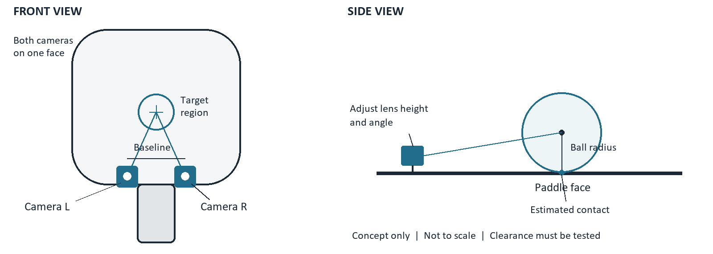

# Pickleball hit area tracker

## 1 Project brief

Build a removable optical accessory that estimates where a ball contacts one pickleball paddle face, reports distance from a chosen center, and gives a short vibration at the player's wrist for a centered contact. Develop it as a three-person sophomore ECE portfolio project, starting with $50 in new spending and progressing toward local machine learning on the paddle accessory.

The recommended first deliverable is a bench prototype with two cameras near the handle-to-face junction, laptop processing, and an adhesive wrist motor controlled by the existing ESP32. Prove stationary contact localization first, then controlled slow impacts. Normal-speed play and fully onboard processing are later milestones that require measured camera and processing performance.

### Confirmed resources and constraints

| Item | Project baseline |
|---|---|
| Team | Three sophomore ECE students |
| New spending | $50 total for the initial build; assumed US dollars |
| Available | Laptop, ESP32 board, paddle, printer |
| Printer assumption | Assumed 3D printer; if it is a paper printer, use a cardboard or scrap-plastic fixture first |
| Timing | Start immediately; flexible personal project, with an initial demonstrator in approximately four weeks |
| Coverage | One face initially; both faces are a later extension |
| Long-term objective | Camera processing and ML inference on the paddle accessory; wireless wrist feedback |

### What the project will measure

Use paddle coordinates in millimeters: x is left/right across the face, y points toward the tip, and z points outward from the active face. Set the origin at a documented target center. Report x, y, radial distance from that center, a centered/off-center/uncertain label, and measurement confidence.

For the first experiment, define a centered contact as being within a configurable 25 mm radius. This is a design choice, not a universal pickleball sweet spot. The geometric center, a player's preferred impact region, and the paddle's best mechanical response may differ. Center proximity alone does not establish spin quality, shot placement, power, or overall shot quality.

### Scope boundaries

The first release covers one paddle, a known ball type, controlled indoor lighting, and a fixed camera mount. It includes a data log and a repeatable test. A phone app, custom circuit board, battery sticker, full-speed rallies, and automatic coverage of both faces are deferred. Keep the eventual product concept intact while making each interim demonstration explicit about its operating limits.

Prepared October 28, 2026. All numeric performance thresholds below are proposed engineering targets, not measured results.

## 2 Camera placement and system architecture

Place both cameras at opposite sides of the throat on the same active face, aimed into an overlapping volume above that face. A pair split between the front and back would generally not see the same approaching ball and would not form the intended stereo pair.

### Adjustable mounting experiment

Start with an adjustable fixture, not a permanent paddle modification. Try lens spacing of 30, 45, and 60 mm, and lens heights of approximately 10, 20, and 30 mm above the face plane, where the paddle shape permits. These are experiment settings, not validated dimensions. Record the actual lens centers, angle, mount mass, and ball clearance for each configuration.

The cameras must see the ball's outline near the center, upper face, sides, and lower face. A lens nearly flush with the paddle looks across the surface at a grazing angle; the throat, edge guard, hand, and ball itself can hide useful information. Raising the lenses can help visibility but increases interference and impact exposure. Check the full volume occupied by the ball, not only the nominal contact point.

Use a removable throat clamp with padding, rounded edges, captive fasteners, strain relief, and indexed camera positions. Avoid drilling the paddle. Keep all testing stationary until the assembly is secure and its protrusions are understood. Document any inaccessible region as a blind zone.

### First working system

Camera L and camera R send images to the laptop. The laptop performs calibration, ball detection, paired-view localization, event checking, and center-distance scoring. It sends one compact result command over USB serial to the existing ESP32. The ESP32 drives the wrist motor through a motor driver. USB power and loose cables are acceptable only for the controlled bench demonstration.

### Final intended system

Both cameras and the processing electronics sit on the paddle accessory. Local firmware captures images, performs vision or ML inference, estimates contact position, and sends an event to a separate wrist receiver. The receiver drives a reusable motor pod attached with a replaceable adhesive patch. A laptop is used for development, training, and optional data download; it is not required during the final demonstration.

## 3 Feasibility and the experiments that matter

The difficult problem is seeing and timing a fast ball near contact. ML cannot reconstruct trustworthy measurements from frames that never captured the event. Cheap cameras are useful for learning geometry and collecting slow-contact data; that does not establish suitability for normal play.

### Frame rate and exposure are different

The following arithmetic uses an illustrative relative ball speed of 20 m/s. It is an engineering example, not a claim about every pickleball shot. Divide speed by frame rate to obtain the distance traveled between frames.

| Capture rate | Frame interval | Travel at 20 m/s |
|---|---|---|
| 30 frames/s | 33.3 ms | 667 mm |
| 60 frames/s | 16.7 ms | 333 mm |
| 120 frames/s | 8.3 ms | 167 mm |
| 240 frames/s | 4.2 ms | 83 mm |

If the usable approach volume is only 200 mm deep, a ball at that speed passes through it in 10 ms. Even 240 frames/s yields only about 2.4 frame intervals across that window. A trajectory fit therefore needs adequate visibility before and after contact, not just a high advertised frame rate.

Motion blur is governed by exposure time. At the same illustrative speed, limiting motion during exposure to 2 mm requires approximately 100 microseconds, or 1/10,000 second. Test whether the camera can achieve useful exposure and contrast under the available lighting. A global shutter reduces rolling-shutter distortion, but does not by itself solve blur or inadequate sampling.

### Two cameras must observe nearly the same instant

A 5 ms timing error at 20 m/s corresponds to 100 mm of motion. Two Wi-Fi streams are not synchronized merely because they arrive together. Record frame sequence numbers and timestamps at capture, distinguish them from laptop arrival times, and measure timing uncertainty. Clock alignment and frame buffering both matter.

For slow tests, choose the maximum allowed speed from the measured timing uncertainty. For example, a 20 ms mismatch allows at most 0.25 m/s if the motion-related error allocation is 5 mm. This is only one part of the total error budget. If timing is unknown, restrict paired-view localization to stationary placements.

### Week one decision

Keep the throat-mounted concept only if both views resolve the ball at the selected test locations. If it fails, adjust lens height, angle, or baseline. If no usable arrangement exists, record the visibility evidence and try a larger bench fixture or a different optical path. Do not conceal the problem with a classifier trained on a narrow set of easy positions.

## 4 Goal list and acceptance criteria

All goals start open. Assign one named owner and a reviewer before work begins. Meet the bench goals before committing to normal-speed play. Report failures and rejected measurements along with successful results.

| ID | Goal and proposed acceptance criterion | Priority | Owner |
|---|---|---|---|
| G1 | Inventory exact ESP32 variant, printer type, camera options, tools, cables, and delivered prices; remain at or below $50 | Must | All |
| G2 | Show usable views of the ball from both throat cameras at 20 selected contact locations; map blind zones | Must | C |
| G3 | Save reproducible calibration and achieve median error at most 10 mm and 90th-percentile error at most 20 mm on held-out stationary placements | Must | A |
| G4 | Display x, y, center distance, confidence, and centered/off-center/uncertain result | Must | A |
| G5 | Deliver one wrist pulse per accepted centered event; no duplicate pulse in 50 repeated command tests | Must | B |
| G6 | Complete 100 controlled contact trials with at least 80% valid coverage; at least 90% correct centered/off-center decisions on eligible valid trials outside the boundary uncertainty band | Target | A and C |
| G7 | Measure true-impact-to-motor-onset latency; target at most 300 ms at the 90th percentile for the slow live demo | Target | B |
| G8 | Run a 10-minute integrated bench session without reset, mount movement, or unlogged data loss | Must | All |
| G9 | Publish a reproducible repository, CAD/fixture files, BOM, plots, failure analysis, and a 60–90 second demo | Must | All |
| G10 | Train and compare a small ML model against the baseline using session-separated data | Later | A |
| G11 | Run the complete sensing-to-decision path on the accessory with no laptop or cloud dependency | Later | A and B |
| G12 | Add a battery-powered wireless wrist pod and validate comfort, runtime, and link reliability | Later | B and C |
| G13 | Validate faster strokes and the second paddle face with suitable camera coverage and timing | Stretch | All |

### Avoid overstating the score

For a 25 mm centered radius, start with a 10 mm boundary uncertainty band: positions from 15 to 35 mm from the center are boundary cases. Widen that band if the measured error warrants it. Uncertain observations receive no success pulse. Log them explicitly; silence alone cannot distinguish an off-center hit from a missed detection.

Report classification accuracy with its denominator, the uncertain fraction, and total valid coverage. Do not improve the apparent result by quietly discarding difficult contacts. If error remains too large for a 25 mm target region, demonstrate coarse zones until localization improves.

## 5 Parts and a realistic 50 dollar budget

Borrow two suitable cameras to test geometry immediately. Otherwise, two XIAO ESP32-S3 Sense boards are compact candidates for the prototype and later local-ML experiments. Each supplies one camera; the existing ESP32 operates the wrist motor.

Manufacturer prices checked October 28, 2026 exclude tax and shipping. The delivered total must fit the reserve. Supplies are allowances, not quotations. No purchases have been made.

| Item | Quantity | Planned cost USD | Purpose or condition |
|---|---|---|---|
| Laptop, existing ESP32, paddle, printer | Existing | 0.00 | Reuse; confirm ESP32 model and printer type |
| XIAO ESP32-S3 Sense including camera | 2 | 27.98 | $13.99 each listed; verify selected package includes camera [S1] |
| Adafruit DRV2605L breakout | 1 | 7.95 | Motor driver for simple first wiring [S3] |
| Adafruit vibrating mini motor disc | 1 | 1.95 | Wrist actuator [S4] |
| Adhesive, padding, fasteners, print material | Allowance | 4.00 | Reuse stock where possible |
| USB data cables, wire, connectors | Existing or borrowed | 0.00 | Required; additional purchases consume reserve |
| Parts and materials subtotal | | 41.88 | Before delivery charges |
| Tax, shipping, and contingency ceiling | | 8.12 | Multiple suppliers may exceed this allowance |
| Initial spending ceiling | | 50.00 | Check the actual cart before buying |

### Purchase sequence

Test near-focus and visibility with one borrowed or purchased camera before buying the second. This stage is a visibility experiment. Check shipping before splitting an order. If the delivered total exceeds $50, borrow the driver or cameras, use stocked driver components, or defer the second board.

The Seeed documentation currently describes camera revisions that may differ between shipments. Record the actual sensor, lens, firmware, focus setting, and resolution. Do not assume an advertised megapixel count implies high-speed capture, synchronization, or suitable close focus. [S1, S2]

### Alternative parts worth considering

Borrowed USB webcams simplify laptop capture but may be bulky, unsynchronized, or poor at close focus. Borrowed slow-motion phone video can help offline validation. Stocked MOSFETs, diodes, resistors, and decoupling can replace the breakout for an ERM motor. An LRA needs a suitable driver and different configuration.

For a later funded optical upgrade, investigate a hardware-synchronized global-shutter pair such as an Arducam OV9281 stereo kit. Its published modes differ by kit and resolution; confirm the exact host, driver, trigger support, lens, and total system cost before selecting it. A camera multiplexer that alternates views is not a simultaneous stereo system. [S8]

## 6 Camera software and contact localization

Build a conventional vision baseline before a neural network. Keep image capture, calibration, ball detection, localization, event logic, and the feedback interface as separate modules so that a future ML detector can replace only the component it improves.

### Calibration procedure

1. Measure the face dimensions and actual ball diameter. Choose and record the origin and center target.
2. Calibrate each camera's lens with a printed checkerboard or ChArUco target photographed at varied orientations and relevant distances. Fix focus and exposure where practical before calibration.
3. Estimate the relationship between cameras and the paddle using a rigid target. Save the calibration, mount revision, sensor mode, and lens settings together. OpenCV provides the calibration and triangulation functions. [S5]
4. Place the actual ball at measured contact locations across the face using a simple fixture. Record both images and known locations. Use this to verify the full mapping and quantify silhouette-related bias.
5. Repeat after removing and replacing the mount. If location error rises materially, add mechanical indexing or require recalibration at setup.

### Practical first algorithm

Restrict processing to a useful image region. Segment the ball using color where the sensor and lighting permit, or use contrast, edges, and contour shape. Reject tiny objects, impossible apparent sizes, inconsistent paired views, and occluded outlines. Pickleball holes can fragment a mask; test contour filling and fit the outer outline rather than counting bright pixels.

For stationary contacts, use calibration observations collected with the ball physically touching the face to build a lookup or fitted mapping from paired image features to paddle coordinates. Validate on locations that were not used to fit the mapping. This is a constrained contact-plane model; it does not estimate arbitrary airborne ball positions.

For moving balls, reconstruct a 3D center trajectory from genuinely time-aligned views. With a spherical undeformed-ball approximation, contact occurs when the center reaches approximately one ball radius from the face plane; project that center onto the face for the estimated contact point. Verify this estimate against independent evidence because ball deformation, paddle deflection, and silhouette fitting introduce error. The center of a fitted image circle or ellipse is not automatically an exact projection of the physical sphere center.

Do not apply a face-plane homography directly to the image center of an airborne ball. The ball center is above the surface, creating parallax. A contact-constrained calibration and a true 3D trajectory are different models and must be evaluated separately.

### Event state machine

Use SEARCH, TRACK, CONTACT_CANDIDATE, CONFIRMED, and COOLDOWN states. A held ball may prove localization, but a hit requires additional temporal evidence such as approach followed by rebound near the surface. If the camera missed that evidence, return uncertain. Start with a 200 ms duplicate-suppression interval and tune it using real events; do not treat a timer as proof of contact.

An optional piezo or accelerometer may mark event timing during development. It does not provide the optical contact location. Keep an optical-only evaluation and a hybrid evaluation separate, and do not describe hybrid performance as purely optical.

## 7 Wrist feedback and electronics

The first sticker is a small motor in a thin insulating holder, attached with replaceable skin-contact adhesive. The existing ESP32 and motor driver can remain on the bench or on a cuff, with a short flexible wire to the patch. A self-contained wireless sticker also needs a radio, power source, protection, and packaging; it is a later hardware project.

### First circuit

Connect the ESP32 to the DRV2605L over I2C, with a common ground and supply/logic levels verified against the exact boards. Connect the ERM motor to the driver's motor outputs and configure ERM mode and drive level for that motor. The DRV2605L supports ERM and LRA actuators, but configuration must match the chosen actuator. [S3, S6]

The reference motor is about 10 mm in diameter and 2.7 mm thick, with a listed current of about 60 mA at 3 V. Budget for startup current and verify the supply. Do not power the motor directly from an ESP32 GPIO. Do not feed USB 5 V into a 3.3 V logic input. Use insulation and wire strain relief. [S4]

If using discrete components instead, use a logic-level N-channel MOSFET as a low-side switch, a gate resistor and pulldown, a flyback diode across the ERM motor, and local supply decoupling. Verify MOSFET conduction at the actual GPIO voltage. This discrete circuit is not the wiring for an LRA or for a differential-output haptic driver.

### Feedback behavior

Begin with one 100 ms pulse for a confident centered contact. Off-center and uncertain results produce no wrist pulse; the laptop shows their distinct statuses. Add a startup test pulse and an explicit ready indicator so the wearer knows whether the system is working. Compare 50, 100, and 150 ms durations for detectability and distraction after electrical testing.

Each result message should contain a protocol version, event ID, result, distance in millimeters, confidence, and a timestamp or age. The receiver acknowledges IDs, rejects duplicates, enforces a maximum pulse duration, and times out safely after a disconnect. Start with USB serial. Add BLE only after verifying that the existing ESP32 variant supports it and that the link meets the measured latency requirement.

### Wearable development

First test the motor on the bench, then briefly on willing team members using an adhesive intended for skin contact. Keep exposed conductors off the skin and stop if the patch causes discomfort. Charge future batteries off-body. Use a protected cell and a compatible charging circuit; do not assume an onboard charger provides every needed protection. Start with a reusable cuff-mounted electronics pod and a replaceable adhesive motor patch before attempting a fully integrated thin sticker.

Measure power during capture, inference, radio activity, and vibration. Estimate runtime from measured average current and battery capacity with a reserve, then verify it experimentally. Mount mass and balance change are also design measurements, not merely packaging concerns.

## 8 Local machine learning on the accessory

The long-term architecture should make the sensing-to-decision path local to the paddle. Training can remain on a laptop. Only the small hit-result message needs to cross the wireless link to the wrist. Running a model on the wrist while images are processed on the laptop would not meet this objective.

### What ML should do

Start by learning ball presence, ball location, or a confidence score when simple segmentation fails under changing lighting. Keep calibrated geometry for distance estimation where it works. A direct centered/off-center image classifier may learn the fixture or background and may not provide reliable millimeter measurements. A small regression model on paired geometric features is another useful baseline, but its assumptions must be tested on independent sessions.

Candidate first image model: a compact convolutional network using a 64 by 64 or 96 by 96 grayscale crop, with a location or presence output. These are experiment sizes, not a promised frame rate. Begin with one camera on an ESP32-S3, then demonstrate both camera paths and their fusion. Quantize to 8-bit integers if the accuracy remains acceptable and the required operators are supported. Espressif's ESP-DL supports optimized inference on ESP32-S3 and ESP32-P4; the original ESP32 has slower C-based implementations. [S7]

### Data collection plan

Start with 300–500 labeled contact events or placements across several sessions. Treat this as a pilot, not a guarantee of sufficient training data. Include centered, off-center, boundary, no-ball, partial-occlusion, motion-blur, and failed-contact cases. Record lighting, speed regime, ball type, mount revision, and sensor settings.

Split data by session, and keep every frame from the same event in the same split. A suggested split is 60% training, 20% validation, and 20% final test by whole sessions. Reserve at least one later recording session as an independent check. For future player or paddle generalization, hold out entire players or paddles. Do not use labels produced by the current tracker as ground truth without independent verification.

### Embedded progression

| Step | Evidence required before advancing |
|---|---|
| Baseline | Measured localization error, coverage, and event accuracy on saved data |
| Laptop ML | Better relevant error or robustness than the baseline on held-out sessions |
| One-camera local inference | Model executes on accessory hardware; measure full capture-to-output latency and memory |
| Two-camera local system | Both streams contribute, capture timing is characterized, fusion runs locally, and the laptop can be disconnected |
| Wearable session | Powered accessory sends real event decisions to the wrist for a documented test duration |

## 9 Embedded architecture and performance budget

Two camera boards provide a practical learning path, but they do not automatically form a synchronized stereo instrument. The final architecture remains a design decision driven by measured timing and image quality.

### Candidate implementations

| Architecture | Benefit | Main limitation |
|---|---|---|
| Two ESP32-S3 camera nodes in one accessory | Each camera can process its own image; compact features can be sent to a fusion node | Separate clocks and exposures; inter-board transfer, frame pairing, and fusion must be engineered |
| Shared processor with a supported synchronized pair | Easier to establish simultaneous observations when the camera system supports it | Likely exceeds the initial budget; host interface, size, power, and mass must be checked |
| One-camera embedded milestone | Fastest way to prove local model execution | Does not complete the two-camera final architecture |

For the dual-node path, each node can extract ball location and confidence, then send a timestamped feature packet over a wired link inside the accessory. One node performs fusion and sends the result to the wrist. A shared synchronization wire may help align clocks or timestamp frame edges, but does not automatically synchronize sensor exposure. Normal-speed stereo may require different camera hardware.

### Measure the whole pipeline

Record capture waiting time, exposure, transfer, decoding, preprocessing, inference, pairing/fusion, event confirmation, radio delivery, and motor startup. A fast model alone does not establish a fast tracker. Distinguish throughput in frames per second from event latency in milliseconds. Report median and 90th-percentile latency, plus worst observed latency for the test session.

Two 320 by 240 grayscale frames contain 153,600 bytes before buffering, model activations, and application memory. Double buffering doubles just that image-storage requirement. A 96 by 96 grayscale model input contains 9,216 bytes, but the network's working memory can be much larger. Log peak memory and avoid assuming that available PSRAM alone guarantees adequate bandwidth.

Espressif's camera driver documentation warns that some image formats and Wi-Fi activity stress memory bandwidth. Benchmark the exact capture mode with radios enabled, not only a standalone inference example. Pin the driver and model-tool versions used for results. [S9]

For a later portable version, propose a 30-minute session target and a sub-150 ms 90th-percentile feedback target, then revise them using measurements and user testing. Do not commit to a tiny battery or a paddle mass target before weighing components and measuring current. Record bare and modified paddle mass and balance point so the tradeoff is visible.

## 10 Team ownership and a fast build schedule

Plan around four weeks to the first documented bench demonstrator at roughly 4–6 hours per person per week. This is a planning estimate, not a deadline. Shipping delays and camera visibility may change it. Use two short coordination meetings and one integrated test each week.

| Person | Primary work | Deliverable | Reviewer |
|---|---|---|---|
| A | Vision, calibration, data processing, later ML | Localization pipeline and reproducible evaluation | C |
| B | ESP32 firmware, motor drive, protocol, later radio and power | Haptic subsystem and timing measurements | A |
| C | Mounting, optical coverage, test fixture, documentation | Adjustable mount, ground-truth method, integration evidence | B |

Rotate one task each week so everyone can explain the entire system. Keep subsystem ownership for accountability, but review circuits, data labels, and evaluation scripts together.

### Four week baseline plan

| Stage | Work | Exit evidence |
|---|---|---|
| First 48 hours | Inventory, define coordinates, borrow or price cameras, sketch mount, make serial command turn on an LED | Written scope, budget, example command and response |
| Week 1 | Test lens placement and close focus, assemble motor circuit, capture paired stationary examples | Visibility map and safe bench pulse; decide whether geometry is viable |
| Week 2 | Calibrate, gather contact locations, implement baseline, build adjustable mount | Held-out stationary error plot and paired-view logs |
| Week 3 | Integrate scoring and wrist output; test controlled slow approaches and impacts if timing permits | First live demonstration with event logs and latency measurement |
| Week 4 | Run independent trials, diagnose failures, clean repository, film demo | G1–G9 evidence or an explicit list of unmet targets |

### After the first demonstration

Spend the next stage improving data coverage and comparing a small ML model to the baseline. Then deploy one model locally and measure it before integrating both camera paths. Schedule full-speed experiments, wearable batteries, and a second face only after the necessary hardware and evidence exist.

If only a weekend is available, demonstrate two-view stationary ball placement, a displayed distance, and a wrist pulse. Label it a contact-location proof of concept. Do not rename it a validated impact tracker. A clear, reproducible limited result is a useful portfolio milestone.

### Shared interface contract

Freeze millimeter units, coordinate direction, event IDs, result labels, and uncertainty behavior before parallel work. Keep calibration files versioned with hardware revisions. Maintain one integration branch or a simple pull-request workflow; require another teammate to reproduce a result before marking a milestone complete.

## 11 Verification and evidence collection

Use independent ground truth. The same algorithm that predicts a contact point cannot also provide the labels used to claim its accuracy. Keep calibration locations separate from evaluation locations, and preserve all attempted trials.

### Test sequence

| Test | Method | Record |
|---|---|---|
| Visibility | Place a real ball at 20 measured locations, including lower face and edges, viewed by both cameras | Visible outline, apparent size, occlusion, blind zones |
| Static accuracy | At least 50 held-out placements; include repeated locations after remounting | x/y error, radial error, median, 90th percentile |
| Controlled contact | At least 100 slow contact attempts after timing is characterized | True event count, detected count, position error, uncertain cases |
| False events | At least 50 near-misses plus hand movement, background motion, and motor activation | False events per trial and per minute |
| Latency | At least 30 accepted events with independent timing | Physical contact to vibration onset; median and 90th percentile |
| Haptics | 50 repeated/duplicate message tests and a short wear test | Duplicate rejection, pulse duration, resets, detectability |
| Reliability | 10-minute integrated run, then remove and reinstall mount | Dropped frames, link loss, drift, temperature observations |

For stationary labels, use a printed millimeter grid on a sacrificial test surface or a positioning jig referenced to paddle edges. Measure the contact location directly. A grid added to the paddle may change its surface; use it only for controlled bench measurement and remove it for later realistic trials.

For moving contacts, use an independent high-speed reference camera if one can be borrowed, or a repeatable fixture with independently measured contact position. A suspended ball or pendulum does not by itself guarantee the actual contact point. Validate alignment and account for flex. If ground truth cannot resolve the event, record an unknown label rather than inventing one.

For end-to-end latency, a development contact switch or piezo and a separate motor-motion sensor can be logged on the same timing instrument. Command acknowledgments show software delivery, not the instant the wrist actually starts vibrating. Keep the reference timing sensor outside the optical estimator when reporting optical-only performance.

### Minimum event log

Store session ID, event ID, mode (static/slow impact/fast impact), camera IDs, capture timestamps, clock uncertainty, frame IDs, calibration version, ground-truth x/y and method, predicted x/y, center distance, confidence, result, rejection reason, send time, acknowledgment, motor onset, and notes. Leave unavailable fields explicitly empty; do not substitute zero.

Plot a paddle heatmap of spatial error, a confusion matrix, error versus speed, and latency distribution. Show results by lighting and camera configuration. Include sample failures and the number of attempts excluded because ground truth was unavailable.

## 12 Risks and design decisions

| Risk | Early evidence | Response |
|---|---|---|
| Throat view hides the ball | Coverage grid contains consistent blind regions | Adjust geometry; narrow the declared operating area or revise optical path |
| Contact falls between frames | No reliable approach/rebound sequence | Reduce test speed; lengthen usable view; investigate faster synchronized cameras |
| Unsynchronized views distort position | Error grows with speed or frame mismatch | Quantify timing; reject mismatched pairs; use stationary mode until solved |
| Near focus is inadequate | Ball outline is soft at relevant distances | Test focus before buying second camera; select suitable lens or move fixture |
| Mount shifts or flexes | Calibration changes after contact/remounting | Add stiffness and indexing; recalibrate and test repeatability |
| Motor resets ESP32 | Voltage dip or reset during pulse | Use a suitable driver/supply, decoupling, and separate current path |
| Success pulse occurs on a near-miss | Good-looking image without impact evidence | Tighten event confirmation and confidence; expand negative tests |
| ML memorizes the setup | Good random-frame split, poor new-session result | Split by session and event; vary backgrounds and lighting |
| Budget exceeds $50 delivered | Cart total consumes shipping reserve | Borrow parts, use stocked driver components, or stage purchases |
| Added mass changes paddle feel | Balance or comfort changes | Measure mass and balance; keep electronics near handle where feasible |

### Decisions to record before building

Fill in these fields as a team: exact ESP32 board; printer type; camera and actual sensor revision; chosen lens spacing and height; target center definition; centered radius; uncertainty band; maximum validated test speed; event-confirmation method; permitted spending; and next milestone date.

For every meaningful decision, record the options, selection, reason, test evidence, owner, and date. Revisit a decision only when new measurements justify it. This gives the final portfolio a clear engineering story.

### Later expansion to both faces

The clearest extension is a separate overlapping camera pair for each face, increasing camera count, power, compute, and mass. A two-camera total design with one camera on each face becomes a monocular-per-face system and needs a new localization method. Mirrors or alternative optical arrangements may preserve sensor count but introduce alignment and packaging work. Treat expansion as a new design review, not a small firmware switch.

Keep this version framed as a training and research accessory. Competition use needs a separate review against the applicable current event and equipment rules; no tournament eligibility is claimed. USA Pickleball maintains official rule and equipment resources. [S10]

## 13 Portfolio deliverables and the next actions

The strongest résumé result will be a working prototype accompanied by measured error, coverage, latency, cost, and an explanation of the tradeoffs. A visible limit, such as slow-speed operation, is useful engineering evidence when it is measured and clearly stated.

### Repository contents

- README with a brief demo, current capabilities, operating limits, setup steps, and the team's contributions.
- Hardware folder with BOM, wiring diagram, exact board versions, power measurements, and assembly photos.
- Mechanical folder with editable CAD, printable files, mount dimensions, and revision notes.
- Firmware folder with camera and wrist code, dependency versions, and the message protocol.
- Vision folder with calibration, baseline estimator, event logic, and evaluation scripts.
- Data documentation with label definitions, session splits, ground-truth method, and a small shareable sample.
- Results folder with error plots, confusion matrices, timing measurements, and failure examples.
- ML folder added when relevant, with training configuration, model version, quantization details, and embedded benchmarks.

### Demonstration outline

In 60–90 seconds, show the mounted cameras and wrist patch, a centered contact, an off-center contact, an uncertain case, and the live distance display. End with measured operating speed, error, coverage, and latency. For the later local-ML milestone, show the laptop disconnected while the complete accessory still makes decisions and drives wrist feedback.

### Résumé wording after measurement

Use a statement such as: “Built a two-camera pickleball contact-localization prototype with ESP32 haptic feedback; achieved [measured error] mm median error across [N] held-out trials at [validated speed], with [coverage]% valid detection coverage.” Replace every bracketed field with a measured value before use.

For a later verified milestone: “Deployed a quantized vision model on [processor] in a paddle-mounted accessory, achieving [measured latency] ms end-to-end feedback latency with [measured accuracy] and [measured runtime] minutes of battery operation.” Do not claim local processing until capture, inference, and event decisions all run without the laptop.

### First 48 hours checklist

- [ ] Confirm the ESP32 model, printer type, available tools, cables, and USB power sources.
- [ ] Assign A, B, and C to actual teammates and choose the first integration date.
- [ ] Measure paddle and ball dimensions and define the target center.
- [ ] Try to borrow two cameras; otherwise verify the delivered first-camera order and total budget.
- [ ] Sketch or print an adjustable throat fixture and check hand/ball clearance.
- [ ] Send a serial command from the laptop to the existing ESP32 and acknowledge it; use an LED until the motor circuit is ready.
- [ ] Capture a ball held at center and at four off-center locations from the proposed camera viewpoints.
- [ ] Create the shared repository and commit scope, budget, protocol, and experiment photos.

## 14 Sources and technical reading

These primary sources support the named parts and software capabilities. Prices are snapshots from October 28, 2026; check the selected variant, stock, tax, shipping, and compatibility before ordering. Geometry choices, goals, budget allowances, and the build schedule are project recommendations to be validated experimentally.

[S1] Seeed Studio. XIAO ESP32-S3 Sense product listing. Reference price $13.99; compact camera-board candidate for the staged prototype.
https://www.seeedstudio.com/XIAO-ESP32S3-Sense-p-5639.html

[S2] Seeed Studio Wiki. Getting Started with XIAO ESP32-S3 Series. Check the actual camera revision and supplied module before fixing calibration or firmware assumptions.
https://wiki.seeedstudio.com/xiao_esp32s3_getting_started/

[S3] Adafruit. DRV2605L Haptic Motor Controller, product 2305. Reference price $7.95; breakout for the first haptic circuit.
https://www.adafruit.com/product/2305

[S4] Adafruit. Vibrating Mini Motor Disc, product 1201. Reference price $1.95; motor dimensions and current examples.
https://www.adafruit.com/product/1201

[S5] OpenCV. Camera Calibration and 3D Reconstruction. Reference for camera models, calibration, and triangulation.
https://docs.opencv.org/4.13.0/d9/d0c/group__calib3d.html

[S6] Texas Instruments. DRV2605L product documentation. Electrical limits and ERM/LRA driver behavior.
https://www.ti.com/product/DRV2605L

[S7] Espressif. ESP-DL Getting Started. Supported inference targets and deployment requirements.
https://docs.espressif.com/projects/esp-dl/en/latest/getting_started/readme.html

[S8] Arducam. Multi-Camera Solution. Distinguishes synchronized camera systems from switching adapters and lists kit-specific modes.
https://docs.arducam.com/Raspberry-Pi-Camera/Multi-Camera-CamArray/Multi-Camera-CamArray/

[S9] Espressif. esp32-camera repository and driver guidance. Capture formats, buffering, and PSRAM considerations.
https://github.com/espressif/esp32-camera

[S10] USA Pickleball. Referee Resources. Entry point for current official rule and equipment resources.
https://usapickleball.org/referee/resources/
